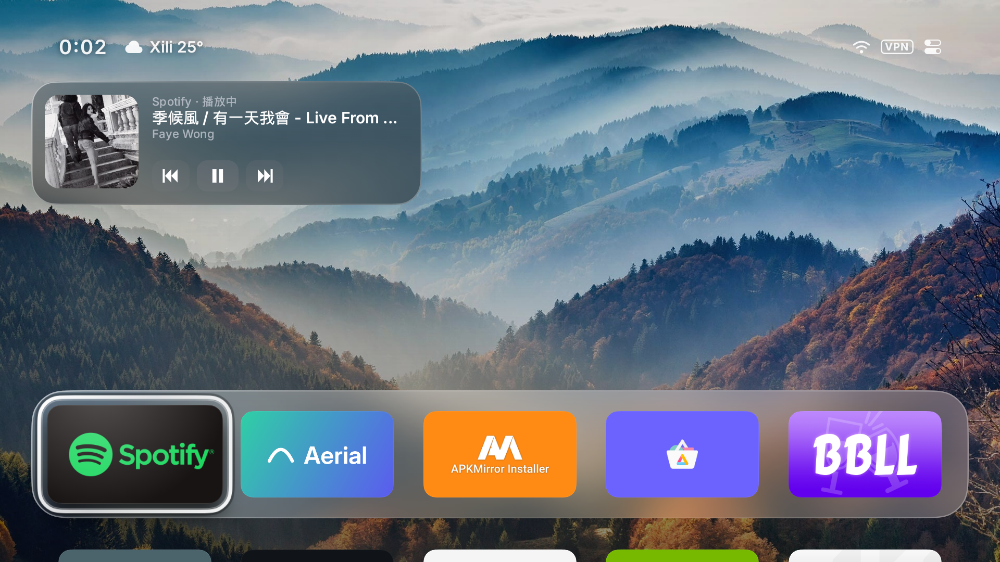

# Now Playing: Sony BRAVIA 4K VH2 (Android TV 12)

Development baseline: `6ed5946e7884920e7e6494443255d2a52ff9774e`.

Test device: Sony 55X90J (owner-reported model; Android reports `BRAVIA 4K VH2`), Android TV 12. Music app: Spotify for Android TV, `com.spotify.tv.android` version `1.83.3` (`versionCode 1830300`).

The image is a screen capture from the test device after the reboot. It shows the current song, artwork, app name, playback label and remote-focusable controls. It does not by itself prove that automatic track changes always refresh.

## MediaSession probe

Tested with Spotify for Android TV (`com.spotify.tv.android`) playing in the background after returning Home to the installed Aerial TV. A small, temporary Android activity queried `MediaSessionManager.getActiveSessions()` using its own enabled notification listener, then read and controlled the Spotify `MediaController`. This tests the API available to Aerial rather than relying only on `dumpsys`.

| Check | Observation |
| --- | --- |
| Active session | Spotify session present while music played behind Home. |
| Metadata | Title, artist and artwork bitmap readable. |
| Play and pause | `TransportControls.pause()` and `.play()` both changed actual audio output. |
| Playback state | Spotify reported `STATE_NONE` both while playing and paused. The reported position was stale. `AudioManager.isMusicActive` matched actual audio output in this single external session case. |
| Next track | The standalone probe and integrated card sent `skipToNext()` and Spotify changed tracks, but its MediaSession retained the old metadata even after a delayed read. The bounded post-control reconciliation cannot recover information Spotify does not publish. |
| Metadata callback, session removal, other apps | Not yet verified on this device. |

## Integrated Home test

The installed Aerial TV uses a different signing key from the local build, so a temporary guard debug build with a distinct application ID was installed alongside it. The original installation was not replaced. With Spotify in the background:

| Check | Observation |
| --- | --- |
| Home card | Song title, artist, Spotify name, artwork and paused/playing labels displayed correctly. Above Dock aligned with the glass plate's outer left edge. |
| Remote | From the second app tile, D-pad Up reached a card control; Left reached Play; OK resumed Spotify. The card changed to Playing and its button changed to Pause. All three controls were individually focusable. The user later confirmed that skip and pause controls work but reported stale card content after them. |
| Personalize | Four options fit in one row. Above Dock, Top Left (below the small clock and weather), Top Right (below the status pill) and Off were selected and inspected on screen. |
| Permission change | Revoking the temporary build's notification access immediately hid the card; restoring access brought it back without restarting Home. The app shelf remained visible. |
| App and focus | The first app retained initial focus. No crash observed during the tested transitions. |

The user later confirmed that track skipping and pausing take effect but the card always shows the same song. On a follow-up run, Spotify's own foreground overlay showed `Making Believe - 1955 Single Version` while both the Aerial card and `dumpsys media_session` still showed `Just To Have You Back`. The Spotify notification exposed only the generic title and text `Spotify`, and Android's notification statistics showed zero updates. Repeated MediaController reads cannot produce the new song from this session. Whether Sony's own Home obtains it through another system API needs investigation. The test build has a distinct package identity and does not replace the existing launcher.

After rebooting the TV, the owner reported that the card refreshed normally across track changes. This changes the diagnosis: stale metadata was observed in the earlier system session, but it is not a proven permanent limitation of Spotify for Android TV. The reboot may have restored Spotify's session publishing or Aerial's session subscription; the owner report alone does not distinguish these possibilities. Repeat the same track-change test without rebooting after Spotify/Aerial restarts and capture both the card and `dumpsys media_session` if it recurs.

Spotify 1.83.3 also declares an exported `SpotifyMediaBrowseService`. A separate Android `MediaBrowser` probe connected after explicitly declaring package visibility, but the browser returned `spotify_media_browser_root_empty`, rejected root subscription, and exposed the same stale session metadata. The TV's available stock Home activity is `com.dangbei.TVHomeLauncher` (Mango TV); opening it showed no music card in the visible Home screen. The owner clarified that the Sony music card they remembered belonged to an older TV system and is no longer present on this version. No Spotify-specific API or SDK has been added to Aerial.

Spotify's [Android media notifications documentation](https://developer.spotify.com/documentation/android/tutorials/android-media-notifications) describes `com.spotify.music.metadatachanged` and related broadcasts. A temporary receiver with no notification access was registered on this TV while a media-next key changed Spotify's own display from `In My Life - Remastered 2009` to `Have You Ever Seen The Rain`. The receiver got no metadata, playback, or queue broadcast, and registration returned no sticky event. The TV APK also had no matching action string in its DEX. This documented phone-app route is therefore not demonstrated to work with `com.spotify.tv.android` 1.83.3. The temporary receiver app was uninstalled after testing.

Full Home-button return, original wallpaper film, screensaver handoff, large clock, weather-off, two-row layout, session destruction, other music apps and long-duration performance still require a follow-up run. The temporary test applications should be removed after the owner finishes testing.

## Follow-up acceptance run

With a correctly signed build, check all four card positions with large and small clocks, weather on and off, and one and two app rows. Verify D-pad focus from the first and last app tiles, plus OK on each supported control; switching tracks inside Spotify and from Home; pause and resume from another device; session removal after Spotify exits; Aerial film and screensaver behavior; and switching to a second music app. Record whether skip actions actually change tracks on this Spotify version.
